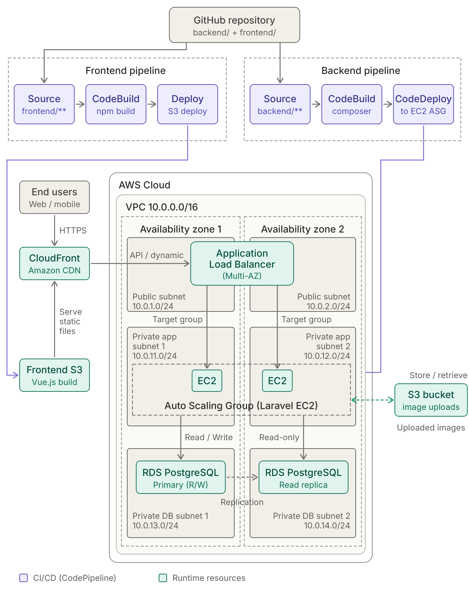
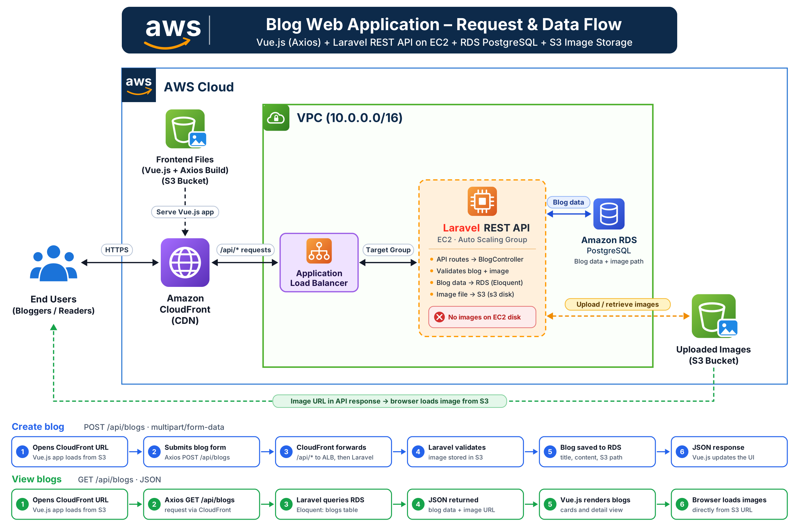
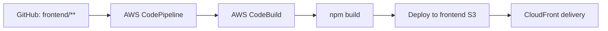
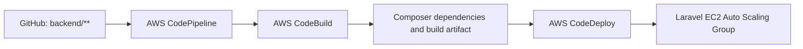

# AWS Three-Tier Blog Web Application with CI/CD


## Project Overview

A full-stack blog web application built with **Vue.js, Laravel and PostgreSQL** and designed around a scalable three-tier architecture on Amazon Web Services (AWS).

The application separates frontend delivery, backend API processing and database storage. Amazon CloudFront acts as the entry point for web users, serving the Vue.js application from Amazon S3 and forwarding API requests to Laravel instances running on Amazon EC2. Blog records are stored in Amazon RDS PostgreSQL, while uploaded images are stored in a separate S3 bucket.

The architecture also includes independent frontend and backend CI/CD pipelines to automate application builds and deployments from a single GitHub repository.

## Table of Contents

- [Architecture Diagram](#architecture-diagram)
- [Technology Stack](#technology-stack)
- [Infrastructure Architecture](#infrastructure-architecture)
- [Network Design](#network-design)
- [Application Request and Data Flow](#application-request-and-data-flow)
- [CI/CD Pipeline](#cicd-pipeline)
- [REST API](#rest-api)
- [Scalability and Reliability](#scalability-and-reliability)
- [Security Considerations](#security-considerations)
- [Repository Structure](#repository-structure)
- [Project Highlights](#project-highlights)

## Architecture Diagram

The following diagram illustrates the AWS infrastructure, multi-AZ network layout and independent deployment pipelines.

<p align="center">
  
</p>

## Technology Stack

| Layer | Technology / AWS service | Purpose |
| --- | --- | --- |
| Frontend | Vue.js, Axios | User interface and HTTP requests |
| Backend | Laravel, PHP, Eloquent ORM | REST API, validation and database operations |
| Database | Amazon RDS for PostgreSQL | Persistent blog records and image paths |
| Object storage | Amazon S3 | Frontend build files and uploaded images |
| Content delivery | Amazon CloudFront | HTTPS entry point and request routing |
| Compute | Amazon EC2, EC2 Auto Scaling | Laravel application hosting and scaling |
| Load balancing | Application Load Balancer (ALB) | Distribution of API traffic |
| Networking | Amazon VPC, public and private subnets | Network isolation across two Availability Zones |
| Source control | GitHub | Frontend and backend source code |
| Pipeline orchestration | AWS CodePipeline | Automated CI/CD workflows |
| Build | AWS CodeBuild | npm builds and Composer dependency installation |
| Deployment | Amazon S3, AWS CodeDeploy | Frontend and backend deployment targets |

## Infrastructure Architecture

### 1. Presentation Tier — Vue.js + S3 + CloudFront

- The Vue.js application provides the interface for bloggers and readers.
- Production frontend assets are stored in an S3 bucket and delivered through CloudFront.
- Axios sends REST API requests using the `/api/*` path.
- CloudFront serves static frontend content from S3 and routes dynamic API requests to the Application Load Balancer.

### 2. Application Tier — Laravel + EC2 + ALB

- Laravel REST API instances run on EC2 within private application subnets across two Availability Zones.
- An Application Load Balancer in the public subnets distributes incoming API traffic through its target group to healthy registered EC2 instances.
- An EC2 Auto Scaling Group manages the application instances.
- Laravel handles API routing, request validation, business logic, database access and image uploads.
- Uploaded images are persisted in S3 instead of being stored on individual EC2 instances.

### 3. Data Tier — RDS PostgreSQL + S3

- Amazon RDS PostgreSQL stores blog data, including titles, content and S3 image paths.
- The primary database handles read and write operations.
- A PostgreSQL read replica in the second Availability Zone provides a separate endpoint for read-only workloads.
- A dedicated S3 bucket stores uploaded image files independently of the frontend bucket and application servers.

> A read replica is not equivalent to an automatic Multi-AZ standby. Laravel must be configured to use separate read and write endpoints for read traffic to benefit from the replica. Replication lag may affect read-after-write consistency.

## Network Design

The architecture uses a VPC with CIDR block `10.0.0.0/16`, divided into six subnets across two Availability Zones.

| Subnet | Availability Zone 1 | Availability Zone 2 | Resources |
| --- | --- | --- | --- |
| Public | `10.0.1.0/24` | `10.0.2.0/24` | Application Load Balancer |
| Private application | `10.0.11.0/24` | `10.0.12.0/24` | Laravel EC2 instances |
| Private database | `10.0.13.0/24` | `10.0.14.0/24` | RDS primary and read replica |

CloudFront and S3 are managed AWS services outside the VPC subnet layout. The load balancer provides the entry point to the private application tier, while the database tier is isolated in private subnets.

## Application Request and Data Flow

<p align="center">
  
</p>

### Create a Blog Post

**Request:** `POST /api/blogs` — `multipart/form-data`

1. The user opens the CloudFront URL and loads the Vue.js application from S3.
2. The user submits a blog form containing text and an image through Axios.
3. CloudFront forwards the API request to the ALB, which routes it to a Laravel EC2 instance.
4. Laravel's `BlogController` validates the submitted data and stores the image in the dedicated S3 bucket using the S3 filesystem disk.
5. Laravel uses Eloquent ORM to save the blog record and S3 image path in the PostgreSQL primary database.
6. The API returns a JSON response, allowing Vue.js to update the user interface.

### View Blog Posts

**Request:** `GET /api/blogs`

1. The Vue.js application sends a GET request using Axios through CloudFront.
2. CloudFront forwards the request to the ALB and Laravel API.
3. Laravel retrieves blog records from PostgreSQL (using the read replica when read routing is configured).
4. The API returns JSON containing blog data and image URLs.
5. Vue.js renders the blog cards or detail view.
6. The browser retrieves images directly from the supplied S3 URLs, subject to the bucket's access configuration.

## CI/CD Pipeline

The GitHub repository contains both frontend and backend source code. The design uses two independent AWS CodePipeline workflows, scoped to changes in their respective directories.

### Frontend Pipeline



| Stage | Description |
| --- | --- |
| Source | Retrieves frontend changes from GitHub (`frontend/**`). |
| Build | AWS CodeBuild installs npm dependencies and runs the frontend production build. |
| Deploy | Publishes the generated static files to the frontend S3 bucket. |
| Delivery | CloudFront serves the frontend assets to end users. |

### Backend Pipeline



| Stage | Description |
| --- | --- |
| Source | Retrieves backend changes from GitHub (`backend/**`). |
| Build | AWS CodeBuild installs Composer dependencies and prepares the Laravel deployment artifact. |
| Deploy | AWS CodeDeploy releases the application to the EC2 Auto Scaling Group. |
| Runtime | The ALB distributes API requests to healthy Laravel instances. |

Independent pipelines allow the frontend and backend to be released separately without requiring an unnecessary deployment of the other component. Directory-specific GitHub triggers need to be configured for this behavior.

## REST API

| HTTP method | Endpoint | Description |
| --- | --- | --- |
| `GET` | `/api/blogs` | Retrieve blog records and their image URLs |
| `POST` | `/api/blogs` | Create a blog post and upload an image |

The API returns JSON responses. Image files are uploaded as multipart form data, stored in Amazon S3 and referenced by the blog records in PostgreSQL.

## Scalability and Reliability

- **Horizontal scaling:** EC2 Auto Scaling allows the application tier to add or remove instances based on configured capacity and scaling policies.
- **Load distribution:** The ALB distributes traffic across healthy registered application instances.
- **Multi-AZ application layout:** EC2 instances are distributed across two Availability Zones to reduce dependency on a single zone.
- **Read scaling:** The PostgreSQL read replica can offload eligible read-only queries from the primary database.
- **Decoupled image storage:** Using S3 for persistent images avoids dependency on an individual EC2 instance's local disk.
- **Content delivery:** CloudFront caches eligible static assets at edge locations to reduce latency and origin traffic.

## Security Considerations

The diagrams show HTTPS access and isolated application and database subnets. The following are recommended configuration practices for this architecture; the diagrams do not establish their implementation status.

- Keep EC2 and RDS instances in private subnets without direct public access.
- Restrict application security group ingress to the ALB security group, and database ingress to the application security group on the PostgreSQL port (`5432`).
- Use least-privilege IAM roles for EC2, S3 and CI/CD services instead of hardcoded AWS credentials.
- Use CloudFront Origin Access Control (OAC) for a private frontend S3 bucket, and restrict direct access to the ALB origin where practical.
- Allow the required HTTP methods and forward necessary request data for `/api/*`; disable caching for dynamic or sensitive API responses unless explicitly designed for caching.
- Use controlled access or presigned URLs for private uploaded images.
- Store Laravel application secrets and database credentials securely; do not commit `.env` files to GitHub.
- Provide suitable outbound connectivity for private EC2 instances (such as NAT or appropriate VPC endpoints), and configure frontend cache invalidation or versioned assets as required.

## Repository Structure

The following is a high-level repository layout. The `images/` directory is used by this README for the architecture diagrams.

```text
repository/
├── frontend/                 # Vue.js application
├── backend/                  # Laravel REST API
├── images/
│   ├── architecture1.png     # AWS infrastructure and CI/CD
│   └── architecture-2.png    # Application request and data flow
└── README.md
```

Project-specific environment variable names, installation commands, build specification files and deployment hooks depend on the actual source code and are not specified by the architecture diagrams.

## Project Highlights

This project demonstrates the integration of full-stack development, AWS cloud architecture and DevOps practices through:

- Three-tier application architecture using Vue.js, Laravel and PostgreSQL.
- Multi-AZ VPC design with public, private application and private database subnets.
- CloudFront-based frontend delivery and path-based API routing.
- Load-balanced, horizontally scalable EC2 application infrastructure.
- Database read scaling and independent S3 object storage.
- Separate frontend and backend CI/CD pipelines using AWS developer tools.

The architecture is designed to separate application responsibilities, support independent deployments and scale individual layers according to workload requirements.
